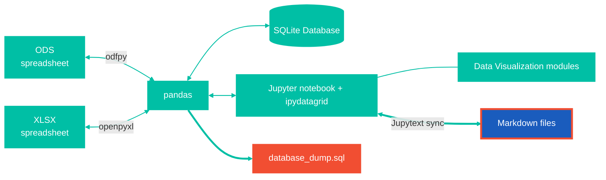
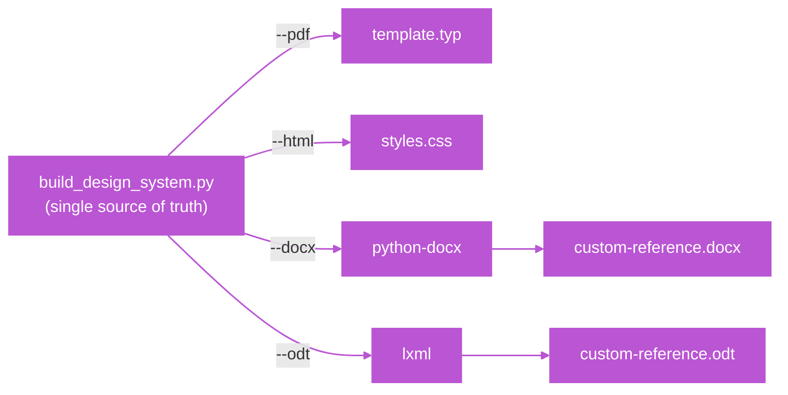
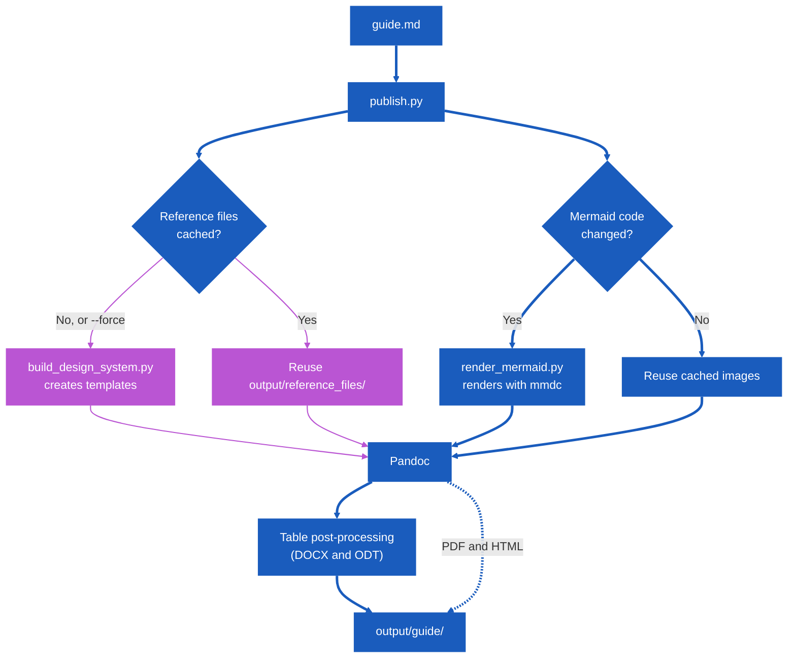

<!-- markdownlint-disable MD025 -->

# VSCodium Environment Setup

> Data Processing • Secure Version Control • Template Creation • Document Generation

## Overall Architecture

```mermaid
flowchart LR
    accTitle: Overall Architecture Diagram
    accDescr: Outlines the entire setup structure. Pandas reads ODS files through odfpy and XLSX files through openpyxl, exchanges data with a SQLite database and Jupyter, and exports a SQL dump. Git with git-remote-gcrypt versions the Markdown files and SQL dump. publish.py calls build_design_system.py when templates are missing or forced, which writes the PDF and HTML templates directly and uses python-docx and lxml from the global Python install to create the DOCX and ODT reference documents. The templates feed into Pandoc, which publish.py runs on the Markdown files, optionally rendering Mermaid diagrams first. PDF output goes through Typst.

    subgraph DP ["uv Python environment"]
        Pandas["pandas"]
        DB[(SQLite Database)]
        Jupyter["Jupyter + ipydatagrid"]
        DataViz["Data Visualization modules"]
    end

    ODS["ODS files"]
    XLSX["XLSX files"]
    Dump["database_dump.sql"]
    MD["Markdown files"]
    Build["build_design_system.py"]
    Typ["template.typ"]
    RefDocx["custom-reference.docx"]
    RefOdt["custom-reference.odt"]
    Css["styles.css"]
    PDF["PDF"]
    DOCX["DOCX"]
    ODT["ODT"]
    HTML["HTML"]

    subgraph VC ["Secure Version Control"]
        Git["Local Git Repo"] <==>|git-remote-gcrypt| Hub["GitHub Remote"]
    end

    subgraph GP ["Global Python"]
        PyDocx["python-docx"]
        Lxml["lxml"]
    end

    Pub["publish.py"]
    Render["render_mermaid.py<br/>via Mermaid CLI (mmdc)"]
    Pandoc["Pandoc"]

    ODS <-->|odfpy| Pandas
    XLSX <-->|openpyxl| Pandas
    Pandas <--> DB
    Pandas <--> Jupyter
    Jupyter --> DataViz
    Jupyter <==>|Jupytext sync| MD
    Pandas ==> Dump
    MD ==> Git
    Dump ==> Git
    MD ==> Pub
    Pub -->|if templates missing or --force| Build
    Build --> Typ
    Build --> Css
    Build --> PyDocx
    Build --> Lxml
    PyDocx --> RefDocx
    Lxml --> RefOdt
    Typ --> Pandoc
    Css --> Pandoc
    RefDocx --> Pandoc
    RefOdt --> Pandoc
    Pub -.->|if mermaid diagrams| Render -.-> Pandoc
    Pub ==> Pandoc
    Pandoc ==>|Typst| PDF
    Pandoc ==> |Lua Filters, postprocessing| DOCX
    Pandoc ==> |Lua Filters, postprocessing| ODT
    Pandoc ==> HTML

    %% Subgraph coloring
    class DP,VC,GP subgraphs;

    %% Nodes Coloring
    class MD,Pub,Render,Pandoc,PDF,DOCX,ODT,HTML blue;
    class Build,Typ,Css,RefDocx,RefOdt,PyDocx,Lxml purple;
    class ODS,XLSX,Pandas,DB,Jupyter,DataViz green;
    class Git,Hub,Dump orange;
    style MD stroke:#f14e32,stroke-width:3.5px;

    %% Lines Coloring
    %% blue thick
    linkStyle 10,24,25,26,27,28 stroke:#1A5CBD,stroke-width:3.5px;
    %% blue thin
    linkStyle 22,23 stroke:#1A5CBD,stroke-width:1.5px;
    %% orange
    linkStyle 0,8,9 stroke:#f14e32,stroke-width:3.5px;
    %% purple
    linkStyle 11,12,13,14,15,16,17,18,19,20,21 stroke:#BA55D3,stroke-width:1.5px;
    %% green thick line
    linkStyle 6,7 stroke:#00BFA5,stroke-width:3.5px;
    %% green slim line
    linkStyle 1,2,3,4,5 stroke:#00BFA5,stroke-width:1.5px;

    %% Nodes Color Definitions
    classDef blue fill:#1A5CBD,stroke:none,color:#fff;
    classDef green fill:#00BFA5,stroke:none,color:#fff;
    classDef purple fill:#BA55D3,stroke:none,color:#fff;
    classDef orange fill:#f14e32,stroke:none,color:#fff;
    classDef subgraphs fill:#ececec,stroke:#ffffff,stroke-width:3.5px,color:#000000;
    classDef Legendsubgraph fill:none,stroke:none,font-size:18px;
    classDef labelStyle fill:none,stroke:none,text-align:left;

    %% Legend Subgraph (Color blocks on left, text labels on right)
    subgraph Legend ["`**Color Legend**`"]
        direction LR
        S1[" "] ---|Document Generation|T1[" "]
        S2[" "] ---|Data Processing|T2[" "]
        S3[" "] ---|Template Creation|T3[" "]
        S4[" "] ---|Version Control|T4[" "]
    end

    class S1 blue;
    class S2 green;
    class S3 purple;
    class S4 orange;
    class T1,T2,T3,T4 labelStyle;
    class Legend Legendsubgraph;

    %% Hide the connecting lines for the legend items
    linkStyle 29,30,31,32 stroke:none;
```



## Section 1: Data Processing VSCodium Setup

### Data Processing Overview



### VSCodium Extensions

Install the following extensions from the VSCodium marketplace:

- **Markdown:** Markdown for Humans, markdownlint, Mermaid Lint, Mermaid Markdown Syntax Highlighting
- **Python & Jupyter:** Python, Jupyter, Jupytext Sync

### Python Local Virtual Environment Setup

We use `uv` for fast Python environment management locally. Our environment relies on a clean structural separation: a local virtual environment managed by `uv` handling data exploration, and an administrative [global Python environment](#command-line-tools) hosting the build scripts, document converters, and template compilation scripts.

#### Create and Activate the Environment

Run the following in PowerShell:

````powershell
# Install uv via winget (if not already installed)
winget install --id=astral-sh.uv -e

# Navigate to home and create the virtual environment
cd $HOME
uv venv shared_data_env

# Activate the environment
.\shared_data_env\Scripts\activate

# Install required Python packages
cd .\shared_data_env\
uv pip install jupyterlab pandas ipykernel odfpy matplotlib tabulate plotly seaborn jupytext ipydatagrid
````

> **Note:** I used `odfpy` here because I like using open source ODS spreadsheet files. If you prefer XLSX files, install `openpyxl` instead.

#### Configure VSCodium Interpreter

1. In VSCodium, open the Command Palette (`Ctrl` + `Shift` + `P`).
2. Type **Python: Select Interpreter**.
3. Choose **Enter interpreter path...** -> **Find...**.
4. Navigate to and select `~/shared_data_env/Scripts/python.exe`.

> **Note:** Uninstall the "Python Environments" extension in VSCodium after selecting your kernel and default interpreter if it causes problems (open source VSCodium doesn't have `pet.exe`).

#### Jupytext Configuration

Jupytext allows you to pair Jupyter notebooks with standard Markdown files for easier version control.

1. Create your workspace folder (e.g., `Documents/PythonProjects`).

2. Create a folder inside it for your notebooks (e.g., `JupyterNotebooks`).

3. Create a `jupytext.toml` file in the root of your workspace:

````toml
    # Pair notebooks in JupyterNotebooks/ with markdown files in markdown_exports/
    formats = "JupyterNotebooks//ipynb,markdown_exports//md"
````

> **Note:** You may have to close VSCodium, reopen your Jupyter Notebook, wait for it to find the Python environment, then make a small change and save the file in order for this to work.

### Visual Data Editing Workflow

Using `ipydatagrid` with SQLite and Pandas allows visual data editing directly inside VSCodium while maintaining Git-trackable plain text SQL dumps.

````mermaid
sequenceDiagram
    accTitle: Visual Data Editing Workflow
    accDescr: Data moves from SQLite into a pandas DataFrame, is edited visually in ipydatagrid, is saved back to SQLite, and is exported as a plain-text SQL dump for Git.

    participant DB as SQLite Database
    participant PD as Pandas DataFrame
    participant Grid as ipydatagrid (Visual)
    participant Git as Git (database_dump.sql)

    DB->>PD: 1. Load data via SQL query
    PD->>Grid: 2. Display in VSCodium
    activate Grid
    Grid->>Grid: 3. User edits cells visually
    Grid->>PD: 4. Sync edits back to DataFrame
    deactivate Grid
    PD->>DB: 5. Save DataFrame to SQLite
    DB->>Git: 6. Export plain-text SQL dump
````

#### Example Workflow Script

````python
import ipydatagrid
import pandas as pd
import sqlite3

# 1. Load data from your local database into a DataFrame
conn = sqlite3.connect("local_data.db")
df = pd.read_sql("SELECT * FROM employees", conn)
conn.close()

# 2. View and edit the data visually right inside your Jupyter notebook/VSCodium
grid = ipydatagrid.DataGrid(df, editable=True)
display(grid)

# (At this point, you can click into cells, fix typos, or add rows directly inside the visual grid canvas.)

# 3. Sync your visual grid edits back into your Pandas DataFrame
df = grid.data

# 4. Save the updated DataFrame back to your local SQLite database
conn = sqlite3.connect("local_data.db")
df.to_sql("employees", conn, if_exists="replace", index=False)

# 5. Export a fresh plain-text SQL dump so Git tracks your visual changes
with open("database_dump.sql", "w") as f:
    for line in conn.iterdump():
        f.write(f"{line}\n")

conn.close()
print("Visual edits saved and exported to database_dump.sql!")
````

Why this works seamlessly:

- **Visual Editing:** You get a clean, responsive spreadsheet grid (`ipydatagrid`) to edit your data without leaving VSCodium.
- **Type Safety:** SQLite and Pandas preserve your exact data types (integers, floats, dates).
- **Git-Friendly:** By running the export step after your editing session, your `database_dump.sql` updates with clean, line-by-line SQL statement diffs ready for version control. Alternatively, you can create a Python script to extract the XML from DOCX, XLSX, ODT, or ODS files (using `zipfile` for all, `openpyxl` for Microsoft file types, or `odfpy` for OpenOffice file types) and apply version control to those files.

---

## Section 2: Secure Version Control via Git Setup (git-remote-gcrypt)

Keep your local files readable while GitHub stores only an encrypted copy of the entire repository.

> **Note:** git-remote-gcrypt is a different tool from git-crypt. git-crypt encrypts selected files inside the repository. git-remote-gcrypt encrypts the whole repository (files, file names, and history) as it is pushed to GitHub, and decrypts it on pull and clone. Your local working copy always stays plain text.

### Secure Version Control Overview

````mermaid
flowchart LR
    accTitle: Secure Version Control Overview
    accDescr: The setup stages in order, from installing the tools and creating a GPG key to pushing the encrypted repository and restoring it on a new machine.

    Install["Install Git and<br/>git-remote-gcrypt"] --> Key["Create and back up<br/>a GPG key"]
    Key --> Repo["Create an empty<br/>GitHub repository"]
    Repo --> Local["Initialize the local repo<br/>and .gitignore"]
    Local --> Remote["Add the gcrypt remote<br/>and set the key"]
    Remote --> Push["Commit and push"]
    Push -.-> Clone["Clone and restore<br/>on a new machine"]

    classDef orange fill:#f14e32,stroke:none,color:#fff;
    class Install,Key,Repo,Local,Remote,Push,Clone orange;

    %% orange
    linkStyle 0,1,2,3,4,5 stroke:#f14e32,stroke-width:3.5px;
````

### Architecture Overview

````mermaid
flowchart LR
    accTitle: git-remote-gcrypt Architecture Overview
    accDescr: Readable local files are encrypted by git-remote-gcrypt when pushed to GitHub, and decrypted again when pulled or cloned on a machine that has the GPG key.

    Local["Local VSCodium<br/>Readable files"] -->|"push: encrypted"| Repo["GitHub<br/>Encrypted data only"]
    Repo -->|"pull or clone: decrypted"| NewPC["New Machine<br/>Readable files"]
    Key(("GPG key")) -.-> Local
    Key -.-> NewPC

    classDef orange fill:#f14e32,stroke:none,color:#fff;
    class Local,Repo,NewPC,Key orange;

    %% orange thick line
    linkStyle 0,1 stroke:#f14e32,stroke-width:3.5px;
    %% orange slim line
    linkStyle 2,3 stroke:#f14e32,stroke-width:1.5px;
````

> **Note:** Because GitHub only stores ciphertext, GitHub's web code viewer, diffs, and pull requests will not show your content.

### Install Prerequisites

1. Ensure **Git for Windows** and **Git Bash** are installed. You don't need Gpg4win because Git for Windows comes with gpg.

2. Download the raw `git-remote-gcrypt` script from the [spwhitton/git-remote-gcrypt](https://github.com/spwhitton/git-remote-gcrypt) repository. The file name must be exactly `git-remote-gcrypt`, with no `.txt` extension, and it must keep its LF line endings, so download the raw file rather than copying its text through an editor.

3. Copy the file to `C:\Program Files\Git\mingw64\libexec\git-core\` (Windows will ask for administrator permission).

4. Close and reopen Git Bash, then check that Git can find the helper:

````bash
    git remote-gcrypt --version
````

The script has no `--version` option, so it prints a few warnings (about the temp directory and experimental rclone support) and then waits for input from Git. Press `Enter` to return to the prompt. Seeing the warnings means the helper was found and runs.

> **Note:** Typing `git-remote-gcrypt` directly in Git Bash gives "command not found". That is expected, because the helper lives in Git's own helper folder rather than on the shell's `PATH`. Git finds it automatically whenever a remote URL starts with `gcrypt::`.

### Create and Back Up a GPG Key

git-remote-gcrypt encrypts the repository with a random key and locks that key to your GPG public key. Only your GPG private key can unlock it.

1. In Git Bash, start the key generator:

    ````bash
        gpg --full-generate-key
    ````

2. Choose these options when prompted:

    - Key type: the default (**ECC (sign and encrypt)**)
    - Curve: the default (**Curve 25519**)
    - Expiry: `0` (the key does not expire)
    - Name and email: anything, they are only labels
    - Passphrase: a strong one, because it protects your GitHub copy
    - Comment: can leave empty.

    A passphrase window will open. If nothing appears, check the taskbar, as it can open behind other windows.

3. Show the key and copy its fingerprint:

    ````bash
        gpg --list-secret-keys --keyid-format long --fingerprint
    ````

    The fingerprint is the 40-character line under `sec`. Remove the spaces when you use it below.

4. Back up the secret key to a folder **outside** your repository, replacing the placeholder text like YOUR_FINGERPRINT and USERNAME:

    ````bash
        gpg --export-secret-keys --armor YOUR_FINGERPRINT > /c/Users/USERNAME/Documents/gcrypt_secret_key.asc
    ````

    - Check that the backup file is not empty, then move it to offline storage such as a USB drive or password manager:

        ````bash
            ls -l /c/Users/USERNAME/Documents/gcrypt_secret_key.asc
        ````

> **Warning:** If you lose the secret key or forget its passphrase, the encrypted copy on GitHub cannot be recovered. Anyone who has both the key file and the passphrase can read your repository, so never store the key file in the repository or on GitHub.

### Create a GitHub Repository

1. Log in to GitHub and click **New repository**.
2. Name your repository (e.g., `python-workspace`).
3. Choose **Private**. The contents are encrypted either way, but a private repository also hides that it exists.
4. **IMPORTANT:** Leave "Add a README file", "Add .gitignore", and "Choose a license" **UNCHECKED**.
5. Click **Create repository**. You will build the remote URL from your username and repository name in a later step.

### Initialize Git Locally

1. In Git Bash, make new repositories start on a branch named `main`:

    ````bash
        git config --global init.defaultBranch main
    ````

    This also makes `git clone` choose the right branch later.

2. cd to your workspace folder (`Documents/PythonProjects`) in VSCodium.

    ````bash
        cd Documents/PythonProjects
    ````

3. Initialize the repository by typing `git init` or alternatively in VSCodium, Open the **Source Control** panel (`Ctrl` + `Shift` + `G`) and click **Initialize Repository**.

### Create .gitignore

Generated documents and notebook sources are rebuilt on demand, so keep them out of the repository. Create a file named `.gitignore` in your workspace root:

````plaintext
# Prevent tracking of dirty runtime notebooks
JupyterNotebooks/

# Exclude compiled distribution documents and the publish.py output folder
output/
*.docx
*.odt
*.pdf

# Ignore temporary lock files created by open office tools
*.odt#
````

### Workspace Directory Layout

Our workspace should now look something like this:

````plaintext
📁 PythonProjects/
│  ├── 📁 JupyterNotebooks/       # Raw analytical notebooks (Untracked)
│  ├── 📁 markdown_exports/       # Synchronized readable documentation source
│  ├── 📄 .gitignore              # Dependency & artifact exclusion list
│  └── 📄 jupytext.toml           # Notebook-to-Markdown pairing logic
````

### Make the First Commit

git-remote-gcrypt cannot push an empty repository, so make a commit first.

- In the VsCodium, in the Source Control panel, Enter a commit message (e.g., "Initial commit") and click **Commit**.

### Connect the Encrypted Remote

1. Open Git Bash and make sure you are in the directory of your repository. If not, cd to that folder.

2. Add the remote. The `gcrypt::` prefix is what tells Git to encrypt and decrypt through git-remote-gcrypt:

    ````bash
        git remote add origin gcrypt::https://github.com/USERNAME/REPONAME.git
    ````

    > **Note:** You get the HTTPS github url from github where you created the repository. Alternatively, you can also this up using SSH but that requires more steps and isn't covered in this guide.

3. Tell git-remote-gcrypt which GPG key to encrypt to and sign with, using the same fingerprint (no spaces) as before:

    ````bash
        git config remote.origin.gcrypt-participants "YOUR_FINGERPRINT"
        git config remote.origin.gcrypt-signingkey "YOUR_FINGERPRINT"
    ````

#### First Push

Push from the terminal so you can see any prompts or errors:

````bash
    git push -u origin main
````

1. Expect two prompts: a GitHub sign-in window (Git Credential Manager, first time only) and your GPG passphrase window.

2. Open the repository on GitHub. You should see a single branch containing unreadable data. That is the encrypted repository, and it means the push worked.

> **Note:** `-u` links your local `main` branch to `origin/main`. Without it, VSCodium shows a **Publish Branch** button instead of **Sync Changes**.

After the first push, everything happens in the VSCodium GUI. Stage with the commit, then click **Sync Changes**. All of these go through git-remote-gcrypt automatically.

### Restore on a New Machine

Do this on a new computer, or on the same one in a temporary folder to test that your backup works.

1. Install Git for Windows and VSCodium, and install the `git-remote-gcrypt` script as described in [Install Prerequisites](#install-prerequisites).

2. Copy your backed-up `gcrypt_secret_key.asc` file to the machine and import it in Git Bash:

    ````bash
        gpg --import /path/to/gcrypt_secret_key.asc
    ````

3. Mark the imported key as trusted so gpg does not warn that it is untrusted. Replace the fingerprint, then type `trust`, `5`, `y`, and `quit` at the prompts:

    ````bash
        gpg --edit-key YOUR_FINGERPRINT
    ````

4. Clone the repository. The `-b main` option tells Git which branch to check out:

    ````bash
        git clone -b main gcrypt::https://github.com/USERNAME/REPONAME.git python-workspace
    ````

5. Configure the new clone so pushes from this machine encrypt to your key:

    ````bash
        cd python-workspace
        git config remote.origin.gcrypt-participants "YOUR_FINGERPRINT"
        git config remote.origin.gcrypt-signingkey "YOUR_FINGERPRINT"
    ````

6. Open the folder in VSCodium. Your files should be readable.

> **Note:** If you clone without `-b main`, Git may print `warning: remote HEAD refers to nonexistent ref, unable to checkout` and leave the folder empty. Your data is intact. Run `git checkout main` inside the folder to fill it in.

---

## Section 3: Template Creation

This workflow turns Markdown into consistently styled PDF, Word (`.docx`), OpenDocument (`.odt`), and HTML documents. Markdown remains the editable source. `publish.py` runs the whole build, `render_mermaid.py` turns Mermaid code into images, Pandoc converts the document, and `build_design_system.py` creates the templates that keep styling consistent. This section sets up the toolchain and explains how the templates are generated.

### Template Creation Overview



### Command Line Tools

Run these steps in PowerShell, in order.

1. Install Pandoc and Typst:

````powershell
    winget install JohnMacFarlane.Pandoc
    winget install --id Typst.Typst
````

1. Install **Node.js** (LTS) from [nodejs.org](https://nodejs.org/). In the installer, tick **Automatically install the necessary tools**. This also installs a global Python. If you already installed Node.js without it, run **Install Additional Tools for Node.js** from the Start menu instead.

2. Close and reopen PowerShell, then confirm everything is on your `PATH`:

````powershell
    node --version
    npm --version
    python --version
````

1. If npm prints an update notice, run the `npm install -g npm@...` command it shows. This step is optional.

2. Allow Puppeteer's install script to run, then install Mermaid CLI:

````powershell
    npm config set allow-scripts puppeteer --location=user
    npm install -g @mermaid-js/mermaid-cli
````

1. Install the Python packages used by `build_design_system.py`:

````powershell
    python -m pip install --upgrade pip
    python -m pip install python-docx lxml
````

> **Note:** The global Python installation runs the build scripts. The [`uv` virtual environment from above](#python-local-virtual-environment-setup) is separate and used for Jupyter and data analysis.
>
> **Warning:** The Node.js route is heavy. Node.js, the additional build tools, and Puppeteer's browser together take roughly 7 GB of disk space. If that is too much, see [Optional: Rendering Diagrams Without Node.js](#optional-rendering-diagrams-without-nodejs).

| Tool                               | Purpose                                        |
|------------------------------------|------------------------------------------------|
| Pandoc                             | Converts Markdown to DOCX, ODT, PDF, and HTML  |
| Typst                              | Typesets the PDF output                        |
| Node.js                            | Runs Mermaid CLI                               |
| `@mermaid-js/mermaid-cli` (`mmdc`) | Renders Mermaid code to SVG and PDF images     |
| Python 3.12                        | Runs the build scripts                         |
| `python-docx`                      | Creates DOCX reference documents               |
| `lxml`                             | Supports XML processing for ODT and DOCX files |

### Generating the Templates

`build_design_system.py` is the **single source of truth** for styling. One run produces matching templates for every format, or you can generate only the formats you want with the corresponding flags.

You normally do not need to run it yourself. `publish.py` (Section 5) runs it automatically whenever a reference file is missing and moves the results into `output/reference_files/`. Run it by hand when you want to experiment with a design. Place `build_design_system.py` in your working directory and use your global Python installation:

````powershell
python .\build_design_system.py --all
python .\build_design_system.py --pdf,docx
````

| Flag     | Generates               | Used for                                       |
|----------|-------------------------|------------------------------------------------|
| `--all`  | Everything below        | All four templates                             |
| `--pdf`  | `template.typ`          | PDF layout and formatting through Typst        |
| `--docx` | `custom-reference.docx` | Word styles, page layout, headers, and footers |
| `--odt`  | `custom-reference.odt`  | OpenDocument styles and formatting             |
| `--html` | `styles.css`            | HTML and CSS styles and formatting             |

> **Styling rule:** You can open the generated DOCX or ODT reference file in Word or LibreOffice to test style changes. For a lasting, reproducible design, make the corresponding change in `build_design_system.py` and rebuild with `publish.py --force`. Otherwise, a later forced rebuild overwrites manual changes.

---

## Section 4: Diagram Rendering and Filters

Final documents need three supporting pieces beyond the templates from Section 3. `render_mermaid.py` turns the Mermaid code in your Markdown into images. Lua filters style lists, task lists, and inline code. Post-processing scripts style tables (see Section 6). `publish.py` coordinates all of them, so you rarely run them yourself.

### How It Works

| Format   | Diagram Images | Lua Filters (Added Only When Needed)                |
|----------|----------------|-----------------------------------------------------|
| **PDF**  | SVG            | None                                                |
| **DOCX** | SVG            | `inline-code.lua`, `definition-list-combined.lua`   |
| **ODT**  | PDF (vector)   | `definition-list-combined.lua`, `task-list-fix.lua` |
| **HTML** | SVG            | None                                                |

`publish.py` scans your Markdown and adds a Lua filter only when the document actually uses inline code, definition lists, or task lists.

### Mermaid Rendering

`render_mermaid.py` finds every fenced `mermaid` code block, saves it as an `.mmd` file, renders it with Mermaid CLI (`mmdc`), and writes a copy of your Markdown in which each block is replaced by an image reference. Pandoc then converts that copy. Your original file is never modified.

Rendering uses `mermaid_config.json`, a Mermaid configuration file that `publish.py` expects in your working directory. This is the one used in this guide:

````json
{
    "layout": "dagre",
    "theme": "default",
    "look": "classic",
    "htmlLabels": false,
    "flowchart": {
        "curve": "basis",
        "nodeSpacing": 50,
        "rankSpacing": 50
    }
}
````

> **Note:** LibreOffice and Inkscape cannot load SVGs of flowchart diagrams, so ODT output uses vector PDF images instead. They are pre-rendered with all layout calculations already done.

#### Accessible Image Descriptions

Add `accTitle` and `accDescr` lines inside a diagram and `render_mermaid.py` uses them as the image title and alt text:

````markdown

````

Every image is also inserted at a width of 6.5 inches.

#### Hash-Based Caching

Rendering through a headless browser is the slowest part of a build, so `render_mermaid.py` avoids repeating it.

1. Each diagram is saved as `image1.mmd`, `image2.mmd`, and so on, numbered in document order.
2. A SHA-256 hash of the diagram code is calculated, and its first 16 characters are saved in a `.sig` file next to the rendered image.
3. On the next run, if the stored hash matches the code and the image file exists, the image is **skipped**. If the code changed, only that diagram is re-rendered.

Hashes are tracked separately for SVG and PDF images. Run `publish.py` with `--force` to ignore the hashes and re-render everything.

> **Note:** Because images are numbered by position, inserting or deleting a diagram shifts the numbers of every diagram after it. Those diagrams are re-rendered once.
>
> **Warning:** Nothing is ever deleted. After you remove a diagram or renumber them, leftover files such as an unused `image9.svg` stay in the output folder. Delete stale files manually from time to time.

### Lua Filters

Lua filters style DOCX and ODT output. DOCX needs them for definition lists and inline code, and ODT needs them for definition lists and task lists. If your Markdown uses none of these, you do not need them.

`inline-code.lua`
: Gives inline code (text between single backticks) a coloured background that matches the PDF and ODT output.

`definition-list-combined.lua`
: Styles definition lists. The same filter works for both ODT and DOCX.

`task-list-fix.lua`
: Removes the bullet point in front of the ballot-box checkbox symbols in ODT files.

Pandoc's default Windows user-data directory is `%APPDATA%\pandoc`. Filters in its `filters` subdirectory can be called by name from any working directory. Create the folder if it doesn't exist and place the Lua filters there:

````plaintext
C:\Users\USERNAME\AppData\Roaming\pandoc\filters\
├── inline-code.lua                # Inline code background (DOCX)
├── definition-list-combined.lua   # Definition lists (ODT + DOCX)
└── task-list-fix.lua              # Removes bullets before checkboxes (ODT)
````

> **Tip:** Run `pandoc --version` to confirm your exact user data directory.

---

## Section 5: Document Generation via publish.py

### Document Generation Overview



### Setup

Save these files together in your working directory:

- `publish.py` and `render_mermaid.py` (the new scripts)
- `build_design_system.py` and `mermaid_config.json`
- `postprocess_docx_tables.py` and `postprocess_tables.py`, which are only needed when your Markdown contains tables
- your Markdown file (for example `guide.md`)

The Lua filters live in Pandoc's `filters` folder (see Section 4).

### Running publish.py

````powershell
# Build every format
python publish.py guide.md --all

# Build only some formats
python publish.py guide.md --pdf
python publish.py guide.md --pdf,docx

# Build everything with citations
python publish.py guide.md --all --citeproc --bibliography references.bib --csl ieee.csl

# Rebuild templates and re-render every diagram
python publish.py guide.md --all --force
````

In one run, `publish.py` does the following:

1. Builds the templates with `build_design_system.py`, but only if they are missing or you pass `--force`.
2. Renders the Mermaid diagrams that are new or changed.
3. Runs Pandoc once per format with the right template, filters, and options.
4. Post-processes DOCX and ODT tables when your Markdown has tables.
5. Writes everything into the output folder.

### Output Folder Layout

Each Markdown file gets its own subfolder named after it. The templates are shared in `reference_files`.

````plaintext
📁 PythonProjects/
│  ├── 📁 output/
│  │  ├── 📁 guide/
│  │  │  ├── 📁 guide-images/
│  │  │  │  ├── 📁 mmd_files/      # image1.mmd, image2.mmd, ...
│  │  │  │  ├── 📁 svg_images/     # image1.svg + image1.sig, ...
│  │  │  │  └── 📁 pdf_images/     # image1.pdf + image1.sig, ... (ODT)
│  │  │  ├── 📄 guide.pdf
│  │  │  ├── 📄 guide.docx
│  │  │  ├── 📄 guide.odt
│  │  │  ├── 📄 guide.html
│  │  │  ├── 📄 guide-svg.md       # Intermediate copy with SVG references
│  │  │  └── 📄 guide-pdf.md       # Intermediate copy with PDF references
│  │  └── 📁 reference_files/      # Generated templates (cached)
│  ├── 📄 build_design_system.py
│  ├── 📄 guide.md
│  ├── 📄 mermaid_config.json
│  ├── 📄 publish.py
│  └── 📄 render_mermaid.py
````

> **Warning:** `publish.py` never deletes files. If you rename a diagram, drop a format, or rename your Markdown file, the old files stay in the output folder. Delete stale files manually.

### publish.py Options

#### Formats

`--all`, `--pdf`, `--docx`, `--odt`, `--html`
: Choose the formats to build. Combine several with commas, such as `--pdf,docx`. The form `--formats pdf,docx` also works.

#### Input and Output

`input` or `-i`, `--input-file`
: The Markdown file to convert. Use `-` to read from standard input.

`-o`, `--output`
: An explicit output path. With one format it is the output file (or a folder, in which case the file keeps the Markdown name). With several formats it is a folder. Use `-o -` to write a single format to standard output.

`--output-dir`
: The base output folder. The default is `output`.

`--cwd`
: Treat another folder as the working directory.

#### Bibliographies

`--citeproc`
: Process citations. Required for any citation handling, including when the bibliography is declared in the YAML header.

`--bibliography`
: A `.bib` file. Can be repeated. Relative paths are resolved from the Markdown file's folder.

`--csl`
: A CSL citation style file such as `ieee.csl`.

#### Rebuilding

`--force`
: Rebuild the templates and re-render every diagram, ignoring the cache.

`--no-design-system`
: Never run `build_design_system.py`. The build stops if a reference file is missing.

#### Advanced

`--pandoc-arg`
: Pass an extra argument through to Pandoc. Can be repeated.

`--resource-path`
: Add an extra folder where Pandoc looks for images and other resources. Can be repeated.

`--mmdc`, `--pandoc`
: Paths to Mermaid CLI and Pandoc if they are not on your `PATH`.

`--design-system-script`, `--mermaid-render-script`, `--mermaid-config`
: Paths to the helper scripts and the Mermaid configuration file if they are not in the working directory.

`--docx-table-postprocessor`, `--odt-table-postprocessor`
: Paths to the table post-processing scripts if they are not in the working directory.

Run `python publish.py --help` to see the full list.

### What publish.py Passes to Pandoc

You never type these yourself, but knowing them helps when you customise a build.

`--toc`
: Generates a table of contents at the top of the document (all formats).

`--to=typst --pdf-engine=typst --template=...`
: Builds the PDF through Typst with the generated `template.typ`.

`--reference-doc=...`
: Takes styles from the generated `.docx` or `.odt` reference file. You can open these files and edit their styles, but a forced rebuild overwrites your edits, so make permanent changes in `build_design_system.py`.

`-M toc-title="Table of Contents"`
: Sets the ODT table of contents title.

`--lua-filter=...`
: Applies the Lua filters your Markdown needs.

`--standalone --css=...`
: Builds a full HTML page, including the heading and DOCTYPE, linked to `styles.css` by a relative path.

`--resource-path=...`
: Helps Pandoc find the rendered images.

### Notes on Output

> **Note:** HTML output links to its images and to `styles.css` by relative paths, so keep the `output` folder structure intact when you move it. For Firefox and possibly other browsers, if the SVG diagrams do not appear, copy the SVG images into the same folder as the HTML file.
>
> **Compilation Note:** Word builds may print non-fatal logs such as "could not convert image... check that rsvg-convert is in path". You can safely ignore them. Pandoc is looking for a system SVG converter, but the Mermaid images have already been generated.

### Table of Contents in Word and LibreOffice

When Pandoc creates a DOCX or ODT with `--toc`, the office application may need to refresh the generated index fields to calculate the final page numbers. An initially blank or incomplete TOC does not necessarily mean conversion failed.

#### Microsoft Word

1. When Word asks whether to update fields when opening the document, choose **Yes**.
2. If the TOC is still incomplete, right-click inside it, select **Update Field**, and update the entire table.

#### LibreOffice Writer

1. Open the ODT file.
2. Choose **Tools → Update → Update All** or press `F9`.
3. Confirm that the TOC fills in and that the following content is correctly paginated.

> **Note:** Autogenerated fields appear with a grey background in LibreOffice Writer by default. These are purely visual and do not print. To remove the grey background, follow the instructions in [Optional: Grey Background Removal in LibreOffice](#optional-grey-background-removal-in-libreoffice).

---

## Section 6: Postprocessing

`publish.py` runs these table-styling scripts automatically on DOCX and ODT output whenever your Markdown contains tables. If you build with Pandoc directly, run the matching script on the finished file:

| Output | Command                                           |
|--------|---------------------------------------------------|
| ODT    | `python .\postprocess_tables.py output.odt`       |
| DOCX   | `python .\postprocess_docx_tables.py output.docx` |

---

## Section 7: Optional Extras

### Optional: Global Mermaid Dark Mode Configuration

To see Mermaid diagrams properly in the built-in Markdown preview (open it from the menu at the top right labeled Text Editor) when VSCodium is in dark mode, either type `%%{init: {'theme': 'dark'}}%%` at the top of every Mermaid code block or configure your VSCodium extension globally so it applies to all diagrams automatically:

1. Open VSCodium Settings (`Ctrl` + `,`).
2. Type `mermaid` in the search bar.
3. Look for settings related to **Markdown Mermaid: Dark Theme** or your specific Mermaid preview extension settings.
4. Set the default dark theme option there (e.g., to `dark` or `base`).

> **Note on the Built-in Editor:** While the Markdown Preview pane and the Markdown for Humans extension will properly respect this global dark theme setting, the built-in inline Markdown editor (the raw text editing canvas) does not. To force dark mode rendering directly inside the code editor blocks, you must include `%%{init: {'theme': 'dark'}}%%` at the top of your Mermaid diagrams.
>
> **Warning:** Remove any `%%{init: ...}%%` dark theme lines before running `publish.py`, or the diagrams in your documents will be rendered with a dark theme.

### Optional: Rendering Diagrams Without Node.js {#optional-rendering-diagrams-without-nodejs}

The Node.js and Mermaid CLI route takes roughly 7 GB of disk space. If you only have a few diagrams, you can render them by hand instead:

1. Install Python directly with `winget install Python.Python.3.12`, and skip the Node.js steps.
2. Open [mermaid.live](https://mermaid.live) and paste in your Mermaid code.
3. Export the diagram as an SVG or PNG file and save it in your workspace.
4. Replace the fenced `mermaid` code block in your Markdown with a normal image reference, such as `{width=6.5in}`.

> **Warning:** `publish.py` looks for Mermaid CLI whenever your Markdown still contains a `mermaid` code block, so remove every block before building. For ODT output, export PNG images instead of SVG, because LibreOffice cannot load SVGs of flowchart diagrams. You also lose automatic re-rendering and hash-based caching, so you must re-export a diagram by hand after every edit.

### Optional: Grey Background Removal in LibreOffice

LibreOffice highlights dynamic content in light grey. This is an application setting, not a document property, so it must be switched off in LibreOffice itself.

**Footer page numbers:** Choose **View > Field Shadings** to toggle the shading off.

**Table of Contents:**

1. Go to **Tools > Options**.
2. Open the **Appearance** tab.
3. Under *Customizations*, select **Index and Table Shadings**.
4. Uncheck **Show in Document** and click **OK**.

### Optional: Bibliographies and Citations

Pandoc formats citations and builds the reference list from a `.bib` file. Pass `--citeproc` to `publish.py`, with the bibliography on the command line or in the YAML header:

````powershell
python publish.py guide.md --docx --citeproc --bibliography references.bib
````

You can omit `--bibliography` if the file is declared in the YAML header. The same applies to the citation style, which is set with a **CSL** (Citation Style Language) file such as `apa.csl`, `ieee.csl`, or `chicago-author-date.csl`. Choose one of two ways to declare them.

#### Option A: YAML Front Matter (Recommended)

````yaml
---
title: "Document Title"
bibliography: references.bib
csl: ieee.csl
---
````

#### Option B: Command Line

````powershell
python publish.py guide.md --all --citeproc --bibliography references.bib --csl ieee.csl
````

You do not need to write CSL files yourself. Download any style from the [Zotero Style Repository](https://www.zotero.org/styles) and place the `.csl` file in your workspace folder.

Cite a source in the Markdown body with its key from `references.bib`:

````markdown
Pandoc supports many output formats [@smith2023; @typst2024, p. 12].
````

The key (i.e. `smith2023`) must match an entry key in `references.bib`.

---

## Troubleshooting

| Symptom                                                                 | Likely Cause                                           | Fix                                                                                               |
|-------------------------------------------------------------------------|--------------------------------------------------------|---------------------------------------------------------------------------------------------------|
| `python` not recognised                                                 | PowerShell opened before install                       | Close and reopen PowerShell                                                                       |
| Could not find Mermaid CLI                                              | `mmdc` is not installed or not on `PATH`               | Run `npm install -g @mermaid-js/mermaid-cli`, then reopen PowerShell                              |
| Diagram fails to render                                                 | Puppeteer's browser did not download                   | Re-run the npm config step, then reinstall Mermaid CLI                                            |
| Mermaid config file not found                                           | `mermaid_config.json` is missing                       | Save it in the working directory or pass `--mermaid-config`                                       |
| Table postprocessor not found                                           | Markdown has tables; script is missing                 | Save the script in the working directory                                                          |
| Mermaid diagram missing in ODT                                          | SVG not supported by LibreOffice                       | Use `publish.py --odt`, which embeds vector PDF images                                            |
| Style change not showing                                                | Reference files are cached                             | Re-run with `--force`                                                                             |
| HTML missing diagrams or styling                                        | HTML moved away from its folders                       | Keep the output folder structure intact                                                           |
| Old files left in output folder                                         | `publish.py` never deletes files                       | Delete stale files manually                                                                       |
| Empty table of contents                                                 | Fields not yet updated                                 | Press `F9` (LibreOffice) or accept the update prompt (Word)                                       |
| Grey highlight on page numbers                                          | LibreOffice field shading                              | Toggle it in **View > Field Shadings**                                                            |
| `rsvg-convert` warning in DOCX                                          | Optional SVG converter missing                         | Safe to ignore                                                                                    |
| `git-remote-gcrypt` not found in Git Bash                               | The helper is in Git's helper folder, not on `PATH`    | Expected. Test with `git remote-gcrypt --version`, or just push                                   |
| `unable to find remote helper for 'gcrypt'`                             | Script has the wrong name or CRLF line endings         | Re-download the raw file, name it exactly `git-remote-gcrypt`, and copy it to Git's helper folder |
| `gpg: WARNING: nothing exported`                                        | A placeholder was used instead of the real fingerprint | Run `gpg --list-secret-keys --keyid-format long --fingerprint` and use the real value             |
| `remote HEAD refers to nonexistent ref` and an empty folder after clone | git-remote-gcrypt does not tell Git the default branch | Clone with `-b main`, or run `git checkout main`                                                  |
